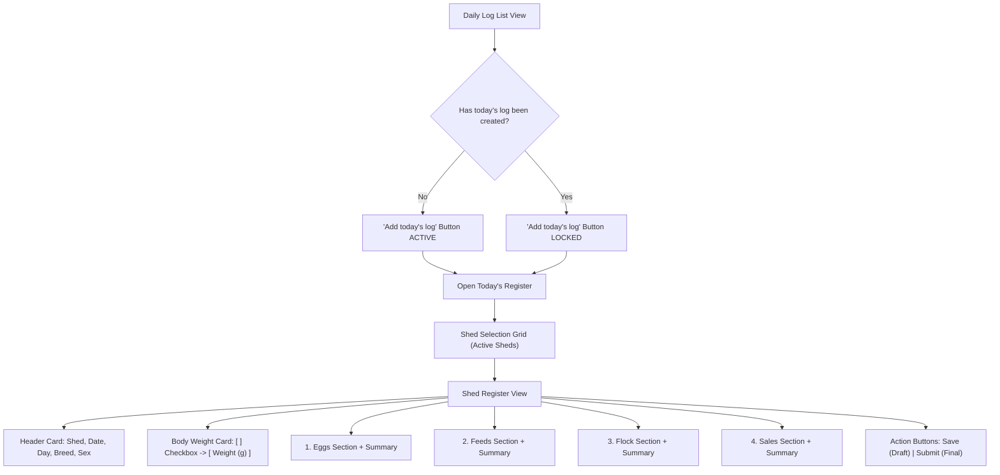

# Functional & Technical Specification: Poultry Daily Log Refactor

**Document Version:** 2.0  
**Target App:** `ob_poultry` (Frappe v17 / ERPNext)  
**Module:** Poultry Management  
**Status:** Approved Specification / Ready for Implementation  
**Spec Path:** [DAILY_LOG_REFACTOR_SPEC.md](file:////wsl.localhost/Ubuntu-24.04/home/frappe/poultry-bench/apps/ob_poultry/docs/DAILY_LOG_REFACTOR_SPEC.md)

---

## 1. Executive Summary & Core Workflow

The **Poultry Daily Log** is refactored from an isolated per-batch entry form into a farm-level **Daily Register**:
1. **Single Entry Guard**: Enforces exactly one daily register per day. The **"Add today's log"** action locks as soon as today's record exists.
2. **Shed-Based Drill Down**: Clicking today's log displays all active **Sheds** (e.g. *Shed 1, Shed 2, Layer Shed A*).
3. **Multi-Batch Tabular Entry**: Clicking a Shed opens a dedicated register with 4 structured tables (one row per active batch in that shed):
   - **Eggs Table** (with combined Tray & Loose Eggs column)
   - **Feeds Table** (with batch consumption, per-bird consumption, and stock valuation)
   - **Flock Table** (with Opening Birds, Mortality, Culls, and Closing Birds)
   - **Sales Table** (with live ERPNext Item Price integration for Good vs Broken eggs)
4. **Draft vs Submit Lifecycle**: Attendants can click **Save** (Draft) throughout the day as work happens, and perform a final **Submit** in the evening to post stock and financial ledgers.
5. **Section KPI Summaries**: Each section features an executive KPI summary card.

---

## 2. Navigation & User Journey



---

## 3. Screen Specifications

### 3.1 List View Guard
- **Action Button Label:** `Add today's log`
- **Locking Logic:**
  - On page load, client queries `Poultry Daily Register` where `log_date = today()`.
  - If a document exists:
    - Button is disabled with lock icon `🔒`.
    - Clicking the today row opens the existing register.
  - If no document exists:
    - Button is enabled with `➕`. Clicking initializes today's register.

---

### 3.2 Shed Header & Weight Card

#### Non-Editable Header Info
| Field | Type | Source / Value |
|---|---|---|
| **Shed Name** | Data | `Poultry Shed.shed_name` |
| **Log Date** | Date | Today's Date (`YYYY-MM-DD`) |
| **Day** | Data | Day of week (`Monday`, `Tuesday`, etc.) |
| **Breed** | Link | Active Batch in Shed &rarr; `breed` |
| **Sex** | Select | Active Batch in Shed &rarr; `Male`, `Female`, or `Mixed` |

#### Weight Recording Toggle
- `[ ] Record Bird Weight Today` (Checkbox, default unchecked)
- `Average Body Weight (g)` (Float, locked/read-only by default; unlocked for input when checkbox is checked).

---

### 3.3 Section 1: Eggs Production Table

#### Table Columns
| # | Column Name | Type | Description & Calculation |
|---|---|---|---|
| 1 | **Batch** | Link | Active Batch ID in this shed |
| 2 | **Week / Day** | Data | Flock age formatted as `W{weeks} D{days}` from batch `start_date` to `log_date` |
| 3 | **Opening Stock** | Int | Yesterday's remaining egg balance (instock) |
| 4 | **Good Eggs** | Int | Standard table/commercial eggs collected |
| 5 | **Double Yolk** | Int | Double yolk eggs collected |
| 6 | **Broken Eggs** | Int | Cracked/broken eggs collected |
| 7 | **Waste Eggs** | Int | Rotten/waste eggs discarded |
| 8 | **Total Produced** | Int | **Auto-Calculated**: `Good + Double Yolk + Broken + Waste` |
| 9 | **Production %** | Percent | **Auto-Calculated**: `(Total Produced ÷ Opening Birds) × 100` |
| 10 | **Broken %** | Percent | **Auto-Calculated**: `(Broken Eggs ÷ Total Produced) × 100` |
| 11 | **Trays (Loose Eggs)** | Data | **Combined Auto-Calculated Column**:<br>`"{Total Produced // 30} Trays ({Total Produced % 30} Eggs)"` |

#### Eggs Section KPI Summary
At the bottom of Section 1:
- **Total Produced Today**: Sum of all batches
- **Total Trays & Loose**: e.g., `142 Trays + 18 Eggs`
- **Average Production %**: Weighted average across all batches
- **Average Broken %**: `(Total Broken ÷ Total Produced) × 100`

---

### 3.4 Section 2: Feeds Consumption & Inventory Table

*Note: Feed is consumed by the whole flock in that batch.*

#### Table Columns & Updated Terminology
| # | Column Name | Type | Description & Calculation |
|---|---|---|---|
| 1 | **Batch** | Link | Batch ID |
| 2 | **Week / Day** | Data | Age (`Wxx Dx`) |
| 3 | **Warehouse** | Dropdown | Prepopulated from Batch default or Shed default.<br>If blank: clicking the cell opens an **inline dropdown** listing active Warehouses (no modal popup). |
| 4 | **Opening Stock (Kg)** | Float | Stock balance in the warehouse before today's feeding *(formerly "Stock Presented Before")* |
| 5 | **Feed Consumed (Kg)** | Float | Total feed consumed by the whole batch today in Kilograms *(formerly "Feed Spent (Kg)")* |
| 6 | **Feed / Bird (g)** | Float | Grams consumed per bird today: `(Feed Consumed Kg × 1000) ÷ Opening Birds` *(formerly "Feed Spent (Gram)")* |
| 7 | **Closing Stock (Kg)** | Float | **Auto-Calculated**: `Opening Stock (Kg) - Feed Consumed (Kg)` *(formerly "Currently Available")* |
| 8 | **Rate / Kg** | Currency | Prepopulated from ERPNext Item Valuation Rate / Standard Buying Rate |
| 9 | **Total Feed Cost** | Currency | **Auto-Calculated**: `Feed Consumed (Kg) × Rate / Kg` |

#### Feeds Section KPI Summary
- **Total Feed Consumed (Kg)**: Sum of feed consumed across all batches
- **Average Feed / Bird (g)**: Overall flock daily intake
- **Total Feed Cost**: Grand total valuation of feed used today

---

### 3.5 Section 3: Chickens (Flock Population & Mortality Table)

#### Table Columns & Updated Terminology
| # | Column Name | Type | Description & Calculation |
|---|---|---|---|
| 1 | **Batch** | Link | Batch ID |
| 2 | **Week / Day** | Data | Age (`Wxx Dx`) |
| 3 | **Opening Birds** | Int | Bird count before today's mortality/culls *(formerly "Presented in batch before")* |
| 4 | **Dead** | Int | Mortality count recorded today |
| 5 | **Culled** | Int | Weak/unproductive birds culled today |
| 6 | **Closing Birds** | Int | **Auto-Calculated**: `Opening Birds - Dead - Culled` *(formerly "Currently alive")* |

#### Flock Section KPI Summary
- **Total Opening Birds**: Flock count at start of day
- **Total Mortality Today**: Total birds lost
- **Total Culled Today**: Total birds culled
- **Total Closing Birds**: Flock count at end of day
- **Daily Mortality %**: `(Total Mortality ÷ Total Opening Birds) × 100`

---

### 3.6 Section 4: Sales (Egg Dispatches & ERPNext Price List Sync)

#### Table Columns & Price List Workflow
| # | Column Name | Type | Description & Calculation |
|---|---|---|---|
| 1 | **Batch** | Link | Batch ID |
| 2 | **Week / Day** | Data | Age (`Wxx Dx`) |
| 3 | **Customer Name** | Link | Customer master from ERPNext (`Customer`) |
| 4 | **Good Eggs Sold** | Int | Number of Good eggs sold |
| 5 | **Double Yolk Sold** | Int | Number of Double Yolk eggs sold |
| 6 | **Broken Eggs Sold** | Int | Number of Broken eggs sold |
| 7 | **Good Eggs Rate** | Currency | **Auto-Fetched** from ERPNext Price List / Daily Egg Rate |
| 8 | **Broken Eggs Rate** | Currency | Defaults to `0` (or empty).<br>**Dynamic Price List Sync**: When user types any rate (e.g. `2.50`), it automatically updates the ERPNext Item Price for Broken Eggs, so future entries auto-fetch the updated rate! |
| 9 | **Total Sales Amount** | Currency | **Auto-Calculated**: `(Good Eggs × Good Rate) + (Double Yolk × DY Rate) + (Broken Eggs × Broken Rate)` |

#### Sales Section KPI Summary
- **Total Good Eggs Sold**
- **Total Double Yolk Sold**
- **Total Broken Eggs Sold**
- **Total Sales Revenue**: Grand total billed amount

---

## 4. Save (Draft) vs Submit Workflow

| Action | When Used | System Effect |
|---|---|---|
| **Save (Draft)** | Attendants logging data during the day (morning egg collection, afternoon feeding). | Saves all tables as Draft (`docstatus: 0`). Can be re-opened and updated at any time. |
| **Submit** | Farm Supervisor in the evening when all logs are verified. | Submits document (`docstatus: 1`).<br>1. Locks the register from further edits.<br>2. Posts ERPNext Stock Entry (Material Issue for feed).<br>3. Updates Batch cumulative mortality, feed, and bird count.<br>4. Generates ERPNext Sales Invoice for recorded sales. |

---

## 5. Technical Implementation Blueprint

### 5.1 DocType Hierarchy
- `Poultry Daily Register` (Parent DocType, unique on `log_date`)
- `Poultry Daily Register Shed` (Child Table: captures Shed level entries)
- Child Tables for each grid:
  - `Poultry Register Egg Entry`
  - `Poultry Register Feed Entry`
  - `Poultry Register Flock Entry`
  - `Poultry Register Sales Entry`

### 5.2 Dynamic Price List Update Method
```python
@frappe.whitelist()
def update_broken_egg_rate(item_code, price_list, new_rate):
    """Updates or creates Item Price for broken eggs upon user edit."""
    if not new_rate or float(new_rate) <= 0:
        return
    item_price = frappe.db.get_value(
        "Item Price",
        {"item_code": item_code, "price_list": price_list},
        "name"
    )
    if item_price:
        frappe.db.set_value("Item Price", item_price, "price_list_rate", new_rate)
    else:
        frappe.get_doc({
            "doctype": "Item Price",
            "item_code": item_code,
            "price_list": price_list,
            "price_list_rate": new_rate
        }).insert(ignore_permissions=True)
    frappe.db.commit()
```
